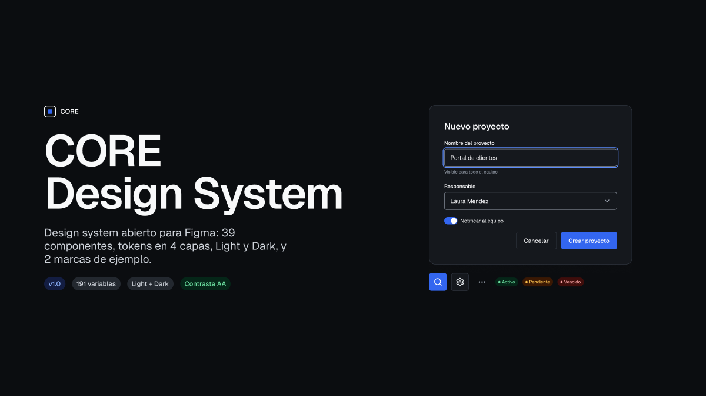
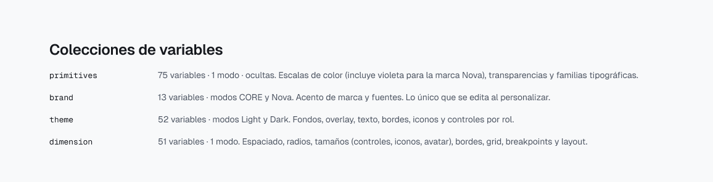
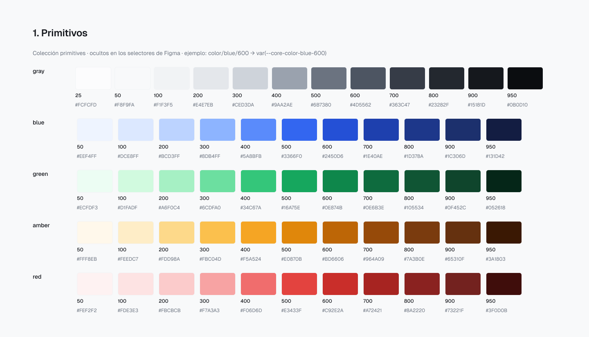
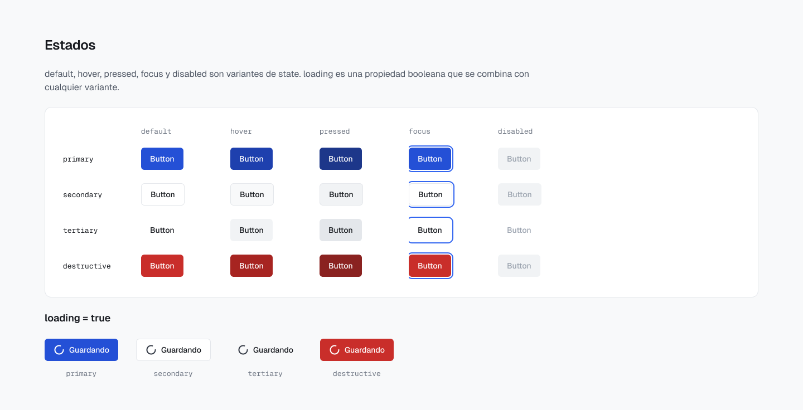
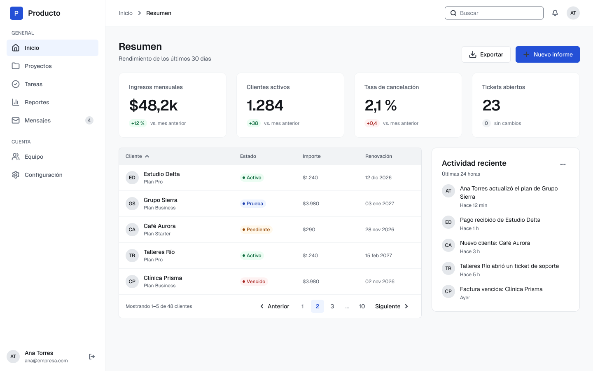
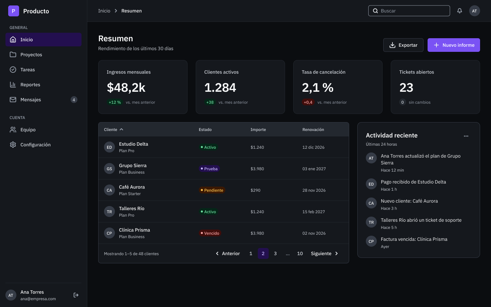

<p align="center">
  
</p>

# CORE Design System

**Design system abierto para Figma** pensado para productos digitales: foundations, variables organizadas en capas, 39 componentes con variantes y estados, temas Light y Dark, y una arquitectura multimarca que permite cambiar de identidad sin duplicar componentes.

Creado por **[@dailyFuenmayor](https://github.com/dailyFuenmayor)**. Diseño de producto, UX/UI y arquitectura del sistema.

**Caso de estudio completo en Behance:** [CORE Design System · Design System para Figma](https://www.behance.net/gallery/258472517/CORE-Design-System-Design-System-para-Figma)

| Versión | Estado | Licencia | Herramienta |
|---|---|---|---|
| v1.0 | Estable | [CC BY 4.0](LICENSE) | Figma (Variables, Component Properties, Auto Layout) |

> **Qué incluye este repositorio:** la documentación del sistema, los tokens de diseño exportados de las variables reales del archivo de Figma (formato DTCG) y capturas seleccionadas.
> **Qué no incluye:** el archivo de Figma (su publicación en Figma Community está pendiente) ni una librería de código. No existe todavía una implementación en React; ver [Hoja de ruta](#hoja-de-ruta).

---

## En números

| | |
|---|---|
| Variables | **191** en 4 colecciones: `primitives` 75 · `brand` 13 · `theme` 52 · `dimension` 51 |
| Modos | `brand`: CORE y Nova · `theme`: Light y Dark |
| Estilos | 13 de texto · 5 de efecto (sombras) · 4 de grilla |
| Componentes | 39 (34 conjuntos con variantes y 5 componentes simples) |
| Iconos | 50, de [Lucide](https://lucide.dev) |
| Patterns | 5: autenticación, formularios y validación, estados vacíos, búsqueda y filtros, manejo de errores |
| Templates | SaaS Dashboard en CORE y Nova, Light y Dark |
| Caso práctico | Acme Projects: producto ficticio con 17 pantallas y prototipo navegable |

## Objetivos

- **Un sistema, no una colección.** Cada componente consume roles semánticos, nunca valores crudos.
- **Escalar sin duplicar.** La marca y el tema son ejes independientes: el mismo componente funciona en CORE o Nova, en Light o Dark.
- **Accesible por defecto.** Contraste comprobado en las cuatro combinaciones de marca y tema, y un foco visible común a todos los componentes interactivos.
- **Legible para diseño y desarrollo.** Los nombres de variables, propiedades y componentes siguen la misma convención que se usaría en código.

## Arquitectura

```
primitives  ──►  brand  ──►  theme  ──►  componentes
(valores)       (identidad)  (roles por    (solo roles
                CORE · Nova   Light/Dark)   semánticos)

dimension: espaciado, radios, tamaños, bordes, grid y layout (independiente de marca y tema)
```

<p align="center"></p>

Detalle en [docs/architecture.md](docs/architecture.md) y [docs/variables.md](docs/variables.md).

## Documentación

| Documento | Contenido |
|---|---|
| [Arquitectura](docs/architecture.md) | Capas, estructura del archivo de Figma y convenciones de nombres |
| [Foundations](docs/foundations.md) | Color, tipografía, espaciado, radios, bordes, elevación, grid e iconografía |
| [Variables](docs/variables.md) | Las 4 colecciones, sus modos y alcances |
| [Temas y marcas](docs/theming.md) | Light y Dark, CORE y Nova, y cómo adaptar CORE a otra marca |
| [Componentes](docs/components.md) | Inventario de los 39 componentes con variantes y propiedades |
| [Patterns y templates](docs/patterns-and-templates.md) | Patrones de interacción, plantilla SaaS Dashboard y caso Acme Projects |
| [Accesibilidad](docs/accessibility.md) | Contraste, foco visible y criterios aplicados |
| [Tokens](tokens/README.md) | Formato DTCG, archivos y cómo combinarlos |
| [Changelog](CHANGELOG.md) | Historial de versiones |

## Vista previa

<table>
  <tr>
    <td width="50%"></td>
    <td width="50%"></td>
  </tr>
  <tr>
    <td></td>
    <td></td>
  </tr>
</table>

## Tokens de diseño

La carpeta [`tokens/`](tokens) contiene las 191 variables del archivo de Figma exportadas al formato del [Design Tokens Community Group](https://www.designtokens.org/) (DTCG), un archivo por colección y modo, más los estilos de texto y sombra. Todas las referencias se verificaron en las cuatro combinaciones de marca y tema: 0 referencias rotas.

```
tokens/
├── primitives.tokens.json
├── brand.core.tokens.json     brand.nova.tokens.json
├── theme.light.tokens.json    theme.dark.tokens.json
├── dimension.tokens.json
├── typography.tokens.json     shadow.tokens.json
└── manifest.json
```

## Licencia y atribución

CORE Design System se distribuye bajo **[Creative Commons Atribución 4.0 Internacional (CC BY 4.0)](LICENSE)**. Puedes copiarlo, redistribuirlo y adaptarlo, incluso con fines comerciales, siempre que indiques la autoría y la licencia, y señales si hiciste cambios.

Atribución sugerida:

> «CORE Design System» por @dailyFuenmayor, bajo CC BY 4.0 (creativecommons.org/licenses/by/4.0/). Modificado: [describe los cambios].

La licencia no cubre el nombre ni el símbolo de CORE como marca. Los recursos de terceros (iconos de Lucide, tipografías Geist e IBM Plex) conservan sus propias licencias: ver [THIRD-PARTY-NOTICES.md](THIRD-PARTY-NOTICES.md). **Acme Projects** y **Nova** son ficticios; los nombres, correos y datos de los ejemplos son inventados.

## Hoja de ruta

- Publicación del archivo de Figma en Figma Community.
- Biblioteca de componentes en código (React, TypeScript y CSS variables) a partir de estos tokens. **Todavía no existe**; cuando se publique tendrá su propia licencia de software.

## Autoría

Diseño, arquitectura del sistema y documentación: **@dailyFuenmayor**.
