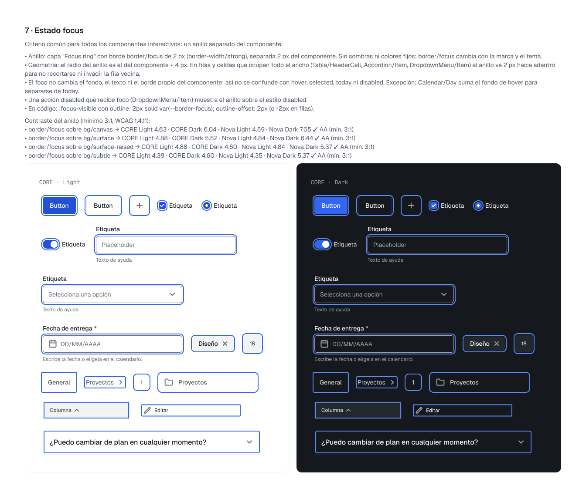

# Accesibilidad

CORE toma WCAG 2.2 nivel AA como referencia. Lo que se indica aquí es lo verificado en el archivo de Figma: contraste calculado y criterios de diseño. **No es una certificación WCAG**; la conformidad final depende de cómo se implemente cada producto.

## Contraste

- 92 pares de contraste comprobados en las cuatro combinaciones de marca y tema (CORE y Nova, Light y Dark) en la revisión de la versión 0.8.
- `text/disabled` está exento de contraste, como permite WCAG para componentes deshabilitados.
- `border/strong` (borde de controles de formulario) y `bg/control/unchecked` (pista del Switch apagado) llegan a 3:1 contra la superficie.
- `bg/action/primary-hover` y `-pressed` en Dark oscurecen el acento para mantener 4,5:1 con texto blanco.

## Foco visible

Criterio común para todos los componentes interactivos: un **anillo separado del componente**.

- Capa "Focus ring" con borde `border/focus` de 2 px (`border-width/strong`), separada 2 px del componente. Sin sombras ni colores fijos: `border/focus` cambia con la marca y el tema.
- El radio del anillo es el del componente + 4 px. En filas y celdas de ancho completo (`Table/HeaderCell`, `Accordion/Item`, `DropdownMenu/Item`) el anillo va 2 px hacia adentro para no recortarse.
- El foco no cambia el fondo, el texto ni el borde propio del componente, así no se confunde con hover, selected, today ni disabled.
- Aplicado en 17 componentes y 57 variantes.
- En código: `:focus-visible` con `outline: 2px solid var(--core-border-focus); outline-offset: 2px` (o `-2px` en filas).

Contraste del anillo (mínimo 3:1, WCAG 1.4.11):

| `border/focus` sobre | CORE Light | CORE Dark | Nova Light | Nova Dark |
|---|---|---|---|---|
| `bg/canvas` | 4,63 | 6,04 | 4,59 | 7,05 |
| `bg/surface` | 4,88 | 5,52 | 4,84 | 6,44 |
| `bg/surface-raised` | 4,88 | 4,60 | 4,84 | 5,37 |
| `bg/subtle` | 4,39 | 4,60 | 4,35 | 5,37 |

## Otros criterios documentados

- Etiquetas visibles en los campos; el estado inválido usa icono y texto, no solo color.
- Los patterns documentan su accesibilidad: por ejemplo, `role="alert"` para el error de inicio de sesión y anuncio de resultados con `aria-live` en búsquedas.
