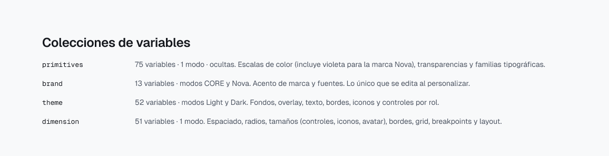
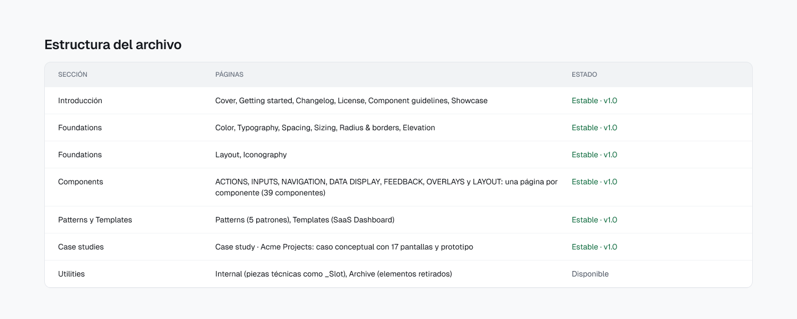
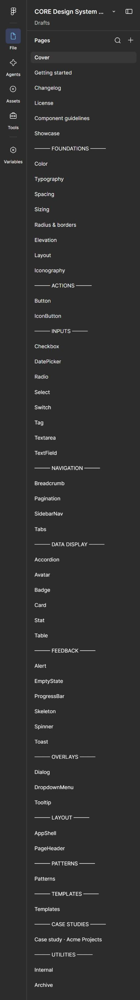
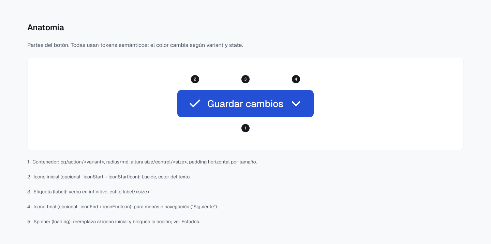

# Arquitectura

CORE está organizado como un producto: capas de tokens con responsabilidades separadas, una biblioteca de componentes que solo consume roles semánticos, y una documentación con la misma plantilla en cada página.

## Capas de tokens

| Capa | Colección de Figma | Modos | Qué guarda | Quién la usa |
|---|---|---|---|---|
| 1. Primitivos | `primitives` | Value | Escalas de color, transparencias y familias tipográficas. Ocultos en los selectores de Figma. | Solo `brand` y `theme` |
| 2. Marca | `brand` | CORE · Nova | Escala de acento (`brand/accent/50–950`) y fuentes (`brand/font/sans`, `brand/font/mono`) | `theme` y estilos de texto |
| 3. Tema | `theme` | Light · Dark | Roles semánticos: fondos, texto, bordes, iconos y controles | Componentes |
| Dimensiones | `dimension` | Default | Espaciado, radios, tamaños, grosores de borde, grid, breakpoints y layout | Componentes y layouts |

```
color/blue/600 ──► brand/accent/600 ──► bg/action/primary ──► Button (variant=primary)
   primitives          brand (CORE)          theme (Light)
```

Reglas:

- Los componentes usan `theme` y `dimension`. Nunca referencian `primitives` directamente.
- Para cambiar de marca se cambia el modo de `brand`; para cambiar de tema, el modo de `theme`. Los dos ejes son independientes, así que un mismo componente funciona en cuatro combinaciones sin variantes duplicadas.



## Estructura del archivo de Figma



El archivo se recorre por capas, con separadores entre secciones:

| Sección | Páginas |
|---|---|
| Introducción | Cover, Getting started, Changelog, License, Component guidelines, Showcase |
| Foundations | Color, Typography, Spacing, Sizing, Radius & borders, Elevation, Layout, Iconography |
| Actions | Button, IconButton |
| Inputs | Checkbox, DatePicker, Radio, Select, Switch, Tag, Textarea, TextField |
| Navigation | Breadcrumb, Pagination, SidebarNav, Tabs |
| Data display | Accordion, Avatar, Badge, Card, Stat, Table |
| Feedback | Alert, EmptyState, ProgressBar, Skeleton, Spinner, Toast |
| Overlays | Dialog, DropdownMenu, Tooltip |
| Layout | AppShell, PageHeader |
| Patterns | Patterns (5 patrones) |
| Templates | Templates (SaaS Dashboard) |
| Case studies | Case study · Acme Projects |
| Utilities | Internal (piezas técnicas como `_Slot`), Archive (elementos retirados) |

Panel de páginas en Figma (captura real de la interfaz):



## Convenciones de nombres

| Elemento | Convención | Ejemplos |
|---|---|---|
| Variables | minúsculas, grupos separados por `/` | `color/blue/600`, `bg/action/primary`, `space/16` |
| Componentes | PascalCase; subcomponentes con `/` | `Button`, `TextField`, `Table/HeaderCell`, `DropdownMenu/Item` |
| Propiedades de variante | camelCase, valores en minúsculas | `variant=primary`, `size=md`, `state=focus` |
| Propiedades booleanas y de texto | camelCase | `showDescription`, `iconStart`, `helperText` |
| Piezas internas | prefijo `_`, no se publican | `_Slot` |

En código, cada variable se corresponde con una CSS custom property con prefijo `core`: `bg/action/primary` → `var(--core-bg-action-primary)`.

## Plantilla de documentación

Cada página de componente sigue la misma estructura: anatomía, variantes, propiedades (con su equivalente de API), estados, temas, accesibilidad y decisiones de diseño.


