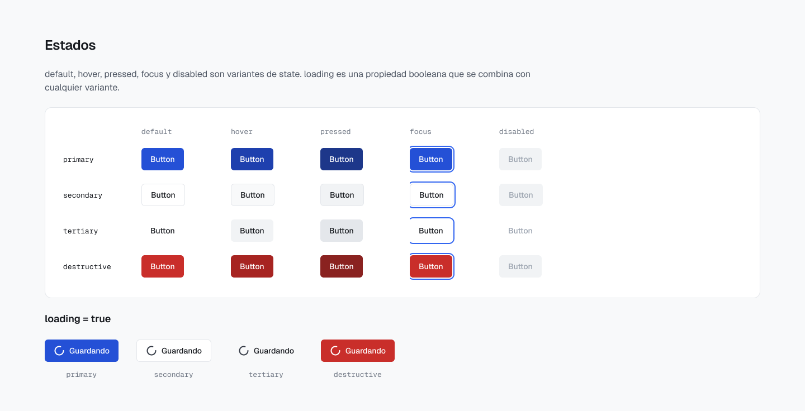
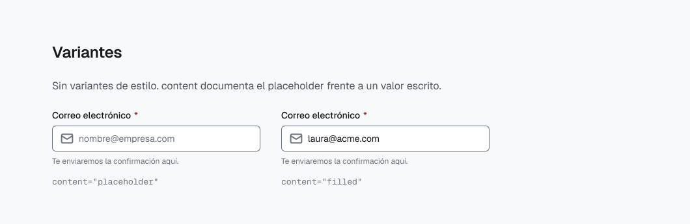
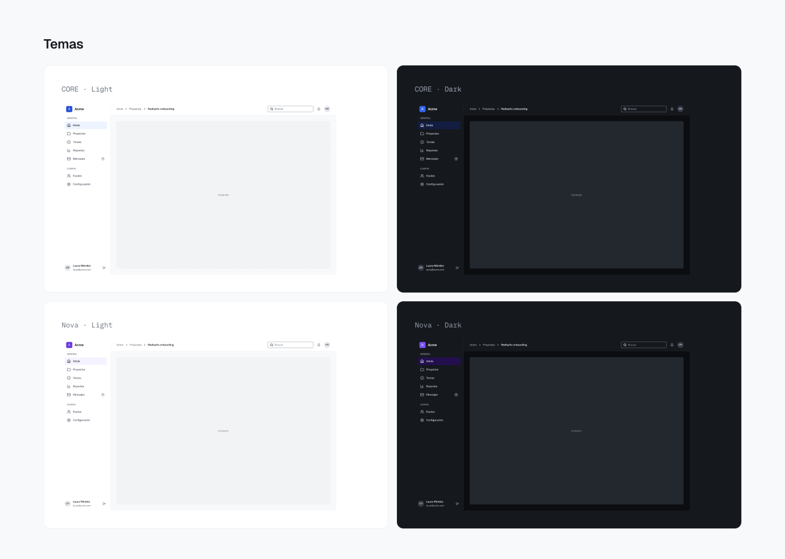
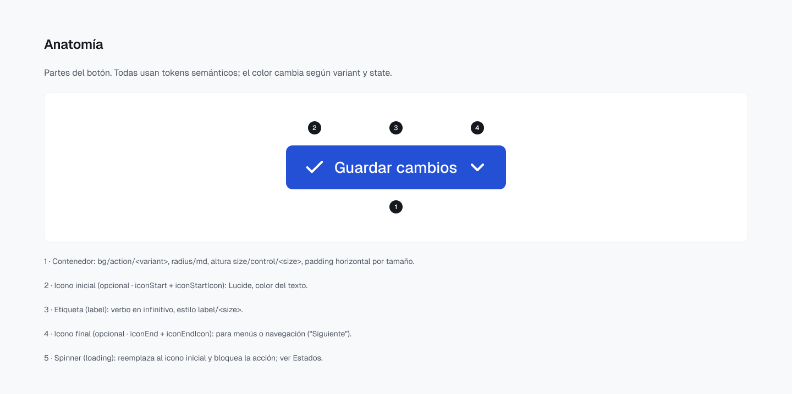

# Componentes

39 componentes en 7 categorías: 34 conjuntos con variantes y 5 componentes simples. Todos usan Auto Layout, propiedades reales de Figma (variantes, booleanos, texto e intercambio de instancias) y solo variables de `theme` y `dimension`.

Inventario tomado del archivo maestro v1.0.

## Actions

| Componente | Variantes | Propiedades |
|---|---|---|
| `Button` | 60 | `variant` primary/secondary/tertiary/destructive · `size` sm/md/lg · `state` default/hover/pressed/focus/disabled · `label` · `loading` · `iconStart` + `iconStartIcon` · `iconEnd` + `iconEndIcon` |
| `IconButton` | 45 | `variant` primary/secondary/tertiary · `size` sm/md/lg · `state` default/hover/pressed/focus/disabled · `icon` |

## Inputs

| Componente | Variantes | Propiedades |
|---|---|---|
| `TextField` | 30 | `size` sm/md/lg · `state` default/hover/focus/invalid/disabled · `content` placeholder/filled · `label` · `showLabel` · `required` · `value` · `helperText` · `showHelper` · `iconStart` + `iconStartIcon` |
| `Textarea` | 10 | `state` default/hover/focus/invalid/disabled · `content` placeholder/filled · `label` · `showLabel` · `required` · `value` · `helperText` · `showHelper` |
| `Select` | 36 | `size` sm/md/lg · `state` default/hover/focus/open/invalid/disabled · `content` placeholder/filled · `label` · `showLabel` · `required` · `value` · `helperText` · `showHelper` |
| `Select/Option` | 4 | `state` default/hover/selected/disabled · `label` · `iconStart` + `iconStartIcon` |
| `Checkbox` | 15 | `checked` false/true/indeterminate · `state` default/hover/focus/invalid/disabled · `label` · `description` · `showLabel` · `showDescription` |
| `Radio` | 10 | `checked` false/true · `state` default/hover/focus/invalid/disabled · `label` · `description` · `showLabel` · `showDescription` |
| `Switch` | 8 | `checked` false/true · `state` default/hover/focus/disabled · `label` · `description` · `showLabel` · `showDescription` |
| `Tag` | 10 | `size` sm/md · `state` default/hover/selected/disabled/focus · `label` · `showIcon` + `icon` · `removable` |
| `DatePicker` | 5 | `state` default/open/invalid/disabled/focus |
| `Calendar` | — | `monthLabel` · `showFooter` |
| `Calendar/Day` | 7 | `state` default/hover/selected/today/outside/disabled/focus · `day` |

## Navigation

| Componente | Variantes | Propiedades |
|---|---|---|
| `Tabs/Trigger` | 5 | `state` default/hover/selected/focus/disabled · `label` · `showIcon` + `icon` · `showCount` + `count` |
| `Breadcrumb/Item` | 4 | `state` default/hover/current/focus · `label` · `showSeparator` |
| `Pagination` | — | Composición de `Pagination/Item` |
| `Pagination/Item` | 5 | `type` page/ellipsis · `state` default/hover/selected/focus · `label` |
| `SidebarNav` | 2 | `collapsed` false/true · `productName` |
| `SidebarNav/Item` | 10 | `collapsed` false/true · `state` default/hover/selected/focus/disabled · `label` · `icon` · `showBadge` + `badge` |

## Data display

| Componente | Variantes | Propiedades |
|---|---|---|
| `Table/HeaderCell` | 6 | `sort` none/asc/desc · `state` default/focus · `label` |
| `Table/Cell` | 8 | `type` text/lead/badge/actions · `state` default/hover · `text` · `title` · `subtitle` |
| `Card` | 2 | `variant` outlined/elevated · `title` · `description` · `showDescription` · `showMenu` · `content` (slot) · `showFooter` |
| `Stat` | 3 | `trend` positive/negative/neutral · `label` · `value` · `showIcon` + `icon` · `showDelta` · `showHint` + `hint` |
| `Badge` | 10 | `tone` neutral/info/success/warning/error · `size` sm/md · `label` · `showDot` |
| `Avatar` | 8 | `type` initials/icon · `size` xs/sm/md/lg · `initials` · `showStatus` |
| `Accordion/Item` | 6 | `expanded` false/true · `state` default/hover/focus · `title` · `content` |

## Feedback

| Componente | Variantes | Propiedades |
|---|---|---|
| `Alert` | 4 | `tone` info/success/warning/error · `title` · `description` · `showDescription` · `showActions` · `dismissible` |
| `Toast` | 5 | `tone` neutral/info/success/warning/error · `title` · `description` · `showDescription` · `showAction` · `dismissible` |
| `EmptyState` | 2 | `tone` neutral/error · `title` · `description` · `showDescription` · `icon` · `showPrimary` · `showSecondary` |
| `ProgressBar` | 22 | `size` sm/md · `value` 0–100 de 10 en 10 · `label` · `valueLabel` · `showLabel` |
| `Spinner` | 3 | `size` sm/md/lg |
| `Skeleton` | 3 | `shape` text/circle/rect |

`ProgressBar`: las variantes de Figma son una aproximación visual; en código, `value` es un número libre con `max` opcional.

## Overlays

| Componente | Variantes | Propiedades |
|---|---|---|
| `Dialog` | 4 | `size` sm/md · `tone` default/destructive · `title` · `description` · `showDescription` · `showContent` + `content` (slot) · `dismissible` · `showFooter` |
| `DropdownMenu` | — | Composición de `DropdownMenu/Item` y `DropdownMenu/Separator` |
| `DropdownMenu/Item` | 8 | `tone` default/destructive · `state` default/hover/disabled/focus · `label` · `showIcon` + `icon` · `showShortcut` + `shortcut` |
| `DropdownMenu/Separator` | — | — |
| `Tooltip` | 4 | `placement` top/bottom/left/right · `label` |

## Layout

| Componente | Variantes | Propiedades |
|---|---|---|
| `AppShell` | 2 | `sidebar` expanded/collapsed · `content` (slot) · `showRootCrumb` · `showParentCrumb` · `showSearch` · `showNotifications` |
| `PageHeader` | — | `title` · `description` + `showDescription` · `showBadge` · `showSecondaryAction` · `showPrimaryAction` · `showMenu` |

## Qué documenta cada página

Anatomía, variantes, propiedades con su equivalente de API, estados, temas (CORE y Nova, Light y Dark), accesibilidad y decisiones de diseño.

