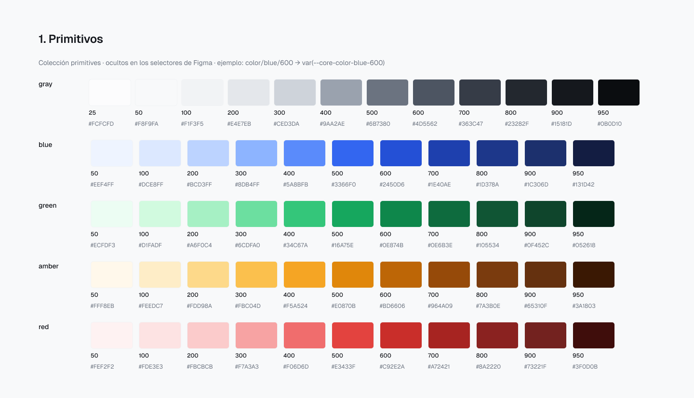
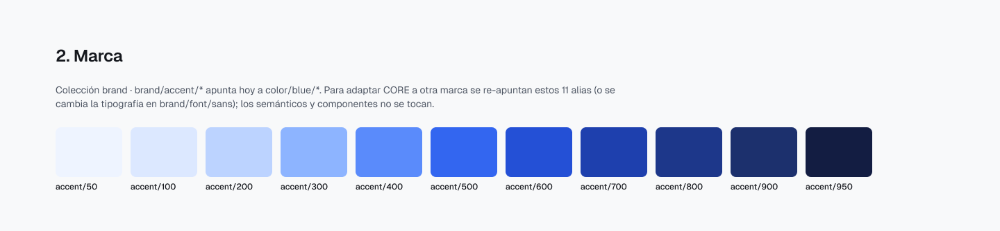
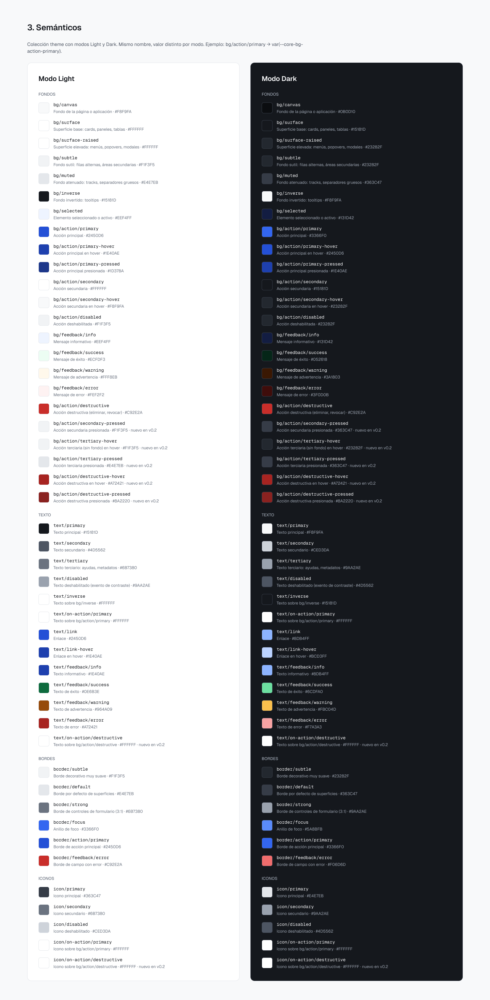
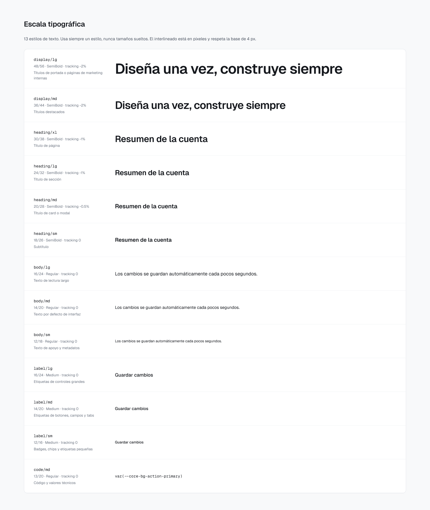
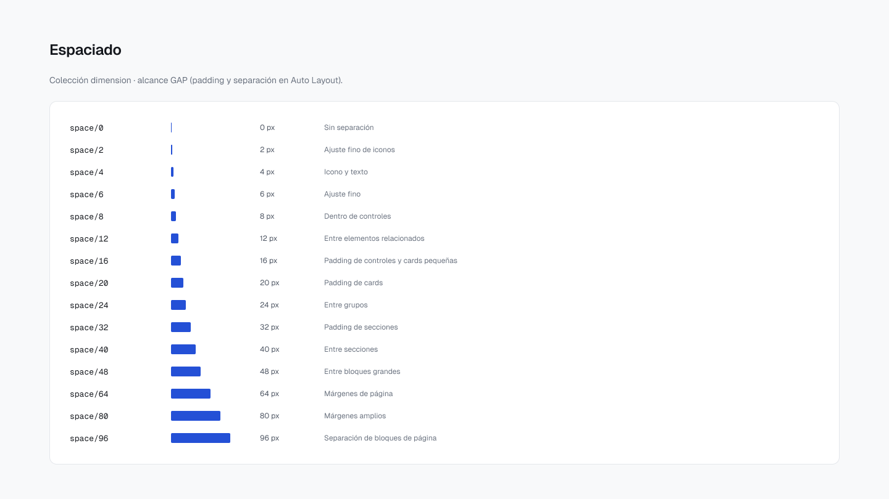

# Foundations

Todos los valores de esta página salen de las variables y estilos del archivo maestro de Figma (v1.0). Los mismos datos están en [`tokens/`](../tokens).

## Color

### Primitivos

La colección `primitives` guarda los valores crudos. Está oculta en los selectores de Figma para que nadie los aplique directamente en un componente.

| Escala | 25 | 50 | 100 | 200 | 300 | 400 | 500 | 600 | 700 | 800 | 900 | 950 |
|---|---|---|---|---|---|---|---|---|---|---|---|---|
| `gray` | `#FCFCFD` | `#F8F9FA` | `#F1F3F5` | `#E4E7EB` | `#CED3DA` | `#9AA2AE` | `#6B7380` | `#4D5562` | `#363C47` | `#23282F` | `#15181D` | `#0B0D10` |
| `blue` | — | `#EEF4FF` | `#DCE8FF` | `#BCD3FF` | `#8DB4FF` | `#5A8BFB` | `#3366F0` | `#2450D6` | `#1E40AE` | `#1D378A` | `#1C306D` | `#131D42` |
| `green` | — | `#ECFDF3` | `#D1FADF` | `#A6F0C4` | `#6CDFA0` | `#34C67A` | `#16A75E` | `#0E874B` | `#0E6B3E` | `#105534` | `#0F452C` | `#052618` |
| `amber` | — | `#FFF8EB` | `#FEEDC7` | `#FDD98A` | `#FBC04D` | `#F5A524` | `#E0870B` | `#BD6606` | `#964A09` | `#7A3B0E` | `#65310F` | `#3A1803` |
| `red` | — | `#FEF2F2` | `#FDE3E3` | `#FBCBCB` | `#F7A3A3` | `#F06D6D` | `#E3433F` | `#C92E2A` | `#A72421` | `#8A2220` | `#73221F` | `#3F0D0B` |
| `violet` | — | `#F5F3FF` | `#EDE9FE` | `#DDD6FE` | `#C4B5FD` | `#A48AFB` | `#7A52F4` | `#6838E0` | `#5728C0` | `#47209C` | `#3A1C7D` | `#230F4F` |

Además: `color/white` `#FFFFFF`, `color/black` `#000000` y dos transparencias para overlays, `color/gray-alpha/50` (`#0B0D10` al 50 %) y `color/gray-alpha/70` (`#0B0D10` al 70 %). La escala `violet` existe para la marca de ejemplo Nova.

### Marca

`brand/accent/50–950` apunta hoy a `color/blue/*` (modo CORE) o a `color/violet/*` (modo Nova). Para adaptar CORE a otra marca se re-apuntan estos 11 alias; los semánticos y los componentes no se tocan. Ver [Temas y marcas](theming.md).

### Semánticos

La colección `theme` traduce la escala a roles: `bg/*`, `text/*`, `border/*`, `icon/*` y `bg/control/*`, con un valor para Light y otro para Dark. Son los únicos colores que usan los componentes. La lista completa está en [Variables](variables.md#theme).

## Tipografía

13 estilos de texto. La familia está enlazada a `brand/font/sans` (Geist en CORE, IBM Plex Sans en Nova) y `brand/font/mono` (Geist Mono o IBM Plex Mono), así que cambiar de marca cambia la tipografía sin editar los estilos. El interlineado se define en píxeles.

| Estilo | Tamaño / interlineado | Peso | Tracking | Uso |
|---|---|---|---|---|
| `display/lg` | 48 / 56 | SemiBold | −2 % | Títulos de portada o páginas de marketing internas |
| `display/md` | 36 / 44 | SemiBold | −2 % | Títulos destacados |
| `heading/xl` | 30 / 38 | SemiBold | −1 % | Título de página |
| `heading/lg` | 24 / 32 | SemiBold | −1 % | Título de sección |
| `heading/md` | 20 / 28 | SemiBold | −0,5 % | Título de card o modal |
| `heading/sm` | 18 / 26 | SemiBold | 0 | Subtítulo |
| `body/lg` | 16 / 24 | Regular | 0 | Texto de lectura largo |
| `body/md` | 14 / 20 | Regular | 0 | Texto por defecto de interfaz |
| `body/sm` | 12 / 18 | Regular | 0 | Texto de apoyo y metadatos |
| `label/lg` | 16 / 24 | Medium | 0 | Etiquetas de controles grandes |
| `label/md` | 14 / 20 | Medium | 0 | Etiquetas de botones, campos y tabs |
| `label/sm` | 12 / 16 | Medium | 0 | Badges, chips y etiquetas pequeñas |
| `code/md` | 13 / 20 | Regular (mono) | 0 | Código y valores técnicos |

## Espaciado

Base de 4 px (con 2 y 6 para ajustes finos). Alcance `GAP`: padding y separación en Auto Layout.

`space/0` 0 · `space/2` 2 · `space/4` 4 · `space/6` 6 · `space/8` 8 · `space/12` 12 · `space/16` 16 · `space/20` 20 · `space/24` 24 · `space/32` 32 · `space/40` 40 · `space/48` 48 · `space/64` 64 · `space/80` 80 · `space/96` 96 (px)

## Tamaños

| Grupo | Valores (px) |
|---|---|
| `size/control` | sm 32 · md 40 · lg 48 (alto de controles) |
| `size/icon` | sm 16 · md 20 · lg 24 |
| `size/avatar` | xs 24 · sm 32 · md 40 · lg 48 |

## Radios y bordes

| Token | Valor |
|---|---|
| `radius/none` · `xs` · `sm` · `md` · `lg` · `xl` · `2xl` | 0 · 2 · 4 · 6 · 8 · 12 · 16 px |
| `radius/full` | 9999 (píldora) |
| `border-width/default` | 1 px |
| `border-width/strong` | 2 px (foco y selección) |

## Elevación

Cinco estilos de sombra, de `shadow/xs` a `shadow/xl`. El foco no usa sombras: es un anillo con `border/focus` (ver [Accesibilidad](accessibility.md)).

| Estilo | Uso |
|---|---|
| `shadow/xs` | Elevación 1: bordes de controles |
| `shadow/sm` | Elevación 1: cards |
| `shadow/md` | Elevación 2: dropdowns y popovers |
| `shadow/lg` | Elevación 3: modales y paneles laterales |
| `shadow/xl` | Elevación 4: toasts y elementos flotantes |

## Grid, breakpoints y layout

| | Mobile | Tablet (desde 768) | Desktop (desde 1280) |
|---|---|---|---|
| Columnas | 4 | 8 | 12 |
| Gutter | 16 | 24 | 24 |
| Margen | 16 | 24 | 32 |

Breakpoints: `breakpoint/md` 768 · `breakpoint/lg` 1280 · `breakpoint/xl` 1536. Estilos de grilla: `grid/mobile`, `grid/tablet`, `grid/desktop` y `grid/baseline-4`.

Layout: `layout/sidebar/width` 256 · `layout/sidebar/collapsed` 72 · `layout/header/height` 64 · `layout/content/max-width` 1280.

## Iconografía

50 iconos de [Lucide](https://lucide.dev) (licencia ISC) como componentes `Icon/<nombre>`, sin modificar la geometría y con un solo vector por icono para que conserven el color al intercambiarlos. Tamaños con `size/icon/*`.

`plus` `minus` `x` `check` `chevron-down` `chevron-up` `chevron-left` `chevron-right` `arrow-left` `arrow-right` `search` `settings` `user` `users` `bell` `house` `menu` `ellipsis` `ellipsis-vertical` `pencil` `trash-2` `copy` `download` `upload` `external-link` `eye` `eye-off` `funnel` `calendar` `mail` `lock` `log-out` `info` `circle-alert` `triangle-alert` `circle-check` `circle-x` `circle-help` `loader-circle` `layout-dashboard` `folder` `file-text` `chart-column` `refresh-cw` `sliders-horizontal` `link` `sun` `moon` `star` `circle`
