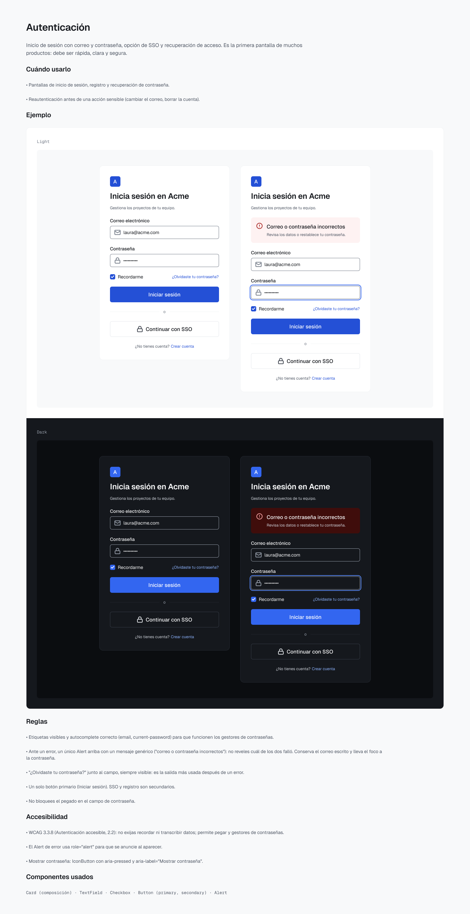
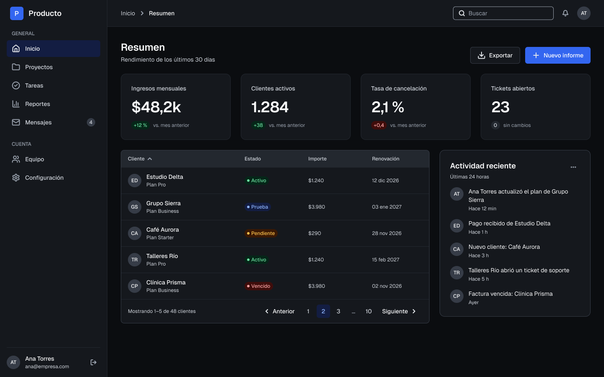
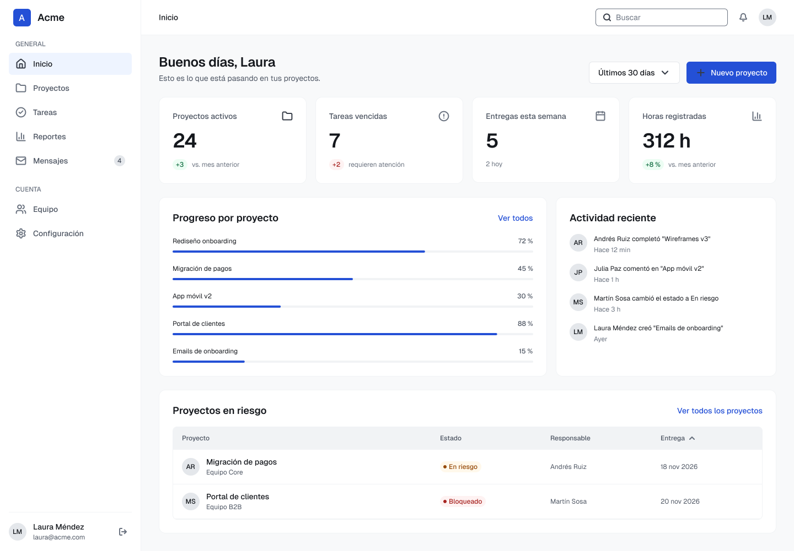
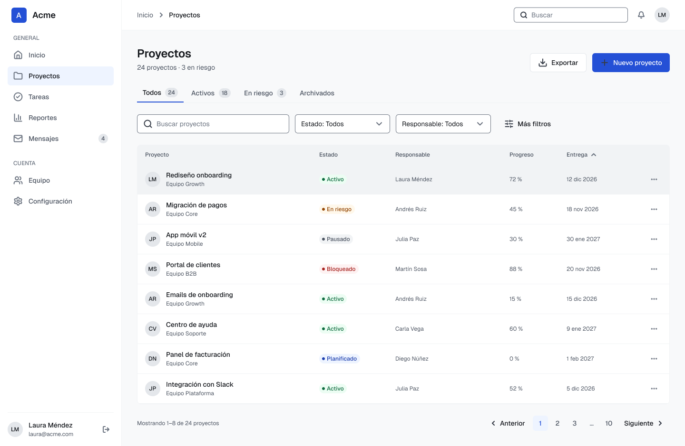

# Patterns, templates y caso práctico

## Patterns

Cinco patrones para problemas recurrentes. Cada uno documenta cuándo usarlo, reglas, accesibilidad y componentes usados, con ejemplos en Light y Dark.

| Pattern | Qué resuelve | Componentes |
|---|---|---|
| Autenticación | Inicio de sesión con correo y contraseña, SSO y recuperación de acceso | Card, TextField, Checkbox, Button, Alert |
| Formularios y validación | Cuándo validar y cómo mostrar errores: resumen arriba y mensaje por campo | TextField, Select, Alert, Button |
| Estados vacíos | Primer uso y búsqueda sin resultados | EmptyState, Button, TextField |
| Búsqueda y filtros | Vista de listado con búsqueda, filtros activos y paginación | TextField, Select, Button, Tag, Table, Badge, Pagination |
| Manejo de errores | Cinco niveles: campo, formulario, sección, acción y página, con una tabla de decisión | TextField, Alert, Toast, EmptyState, Button |

## Template: SaaS Dashboard

Plantilla completa construida solo con componentes de la biblioteca: AppShell, PageHeader, cuatro Stat, una tabla con Pagination y una Card de actividad. Disponible en CORE y Nova, Light y Dark.

## Caso práctico: Acme Projects

Acme Projects es un gestor de proyectos B2B **ficticio** que sirve para probar el sistema en un producto completo:

- 17 pantallas en Light y 17 en Dark, más 10 con la marca Nova.
- Prototipo navegable con 7 flujos.
- Inventario de pantallas con sus componentes y patrones.
- Componentes que faltaban detectados al construir el caso, documentados y justificados.

| | |
|---|---|
|  |  |

Los nombres de personas, correos, proyectos y cifras del caso son inventados.
