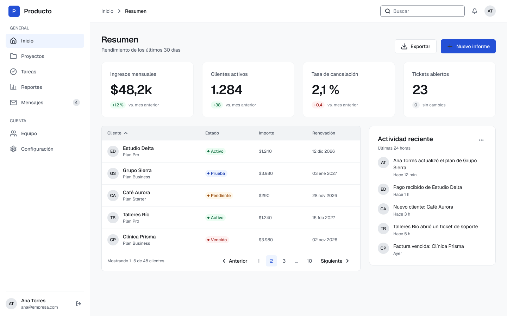
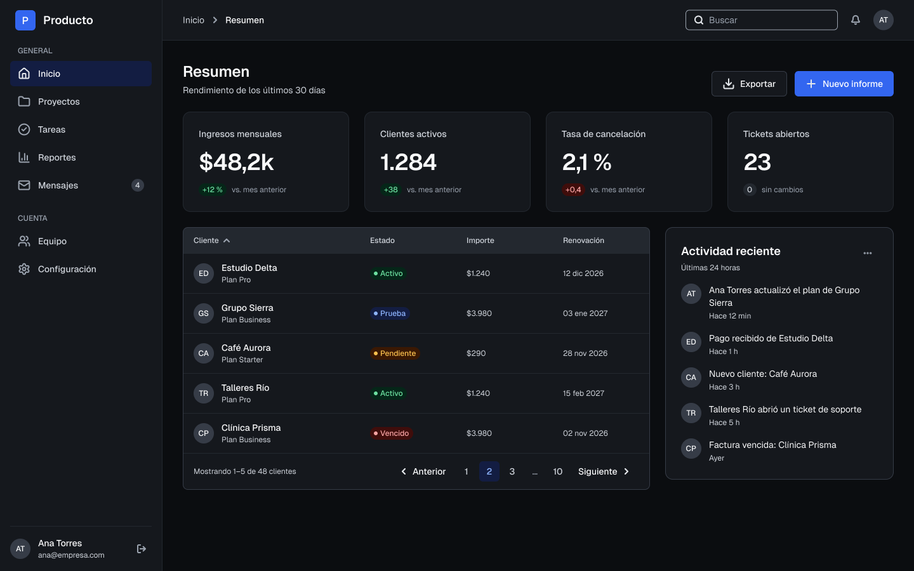
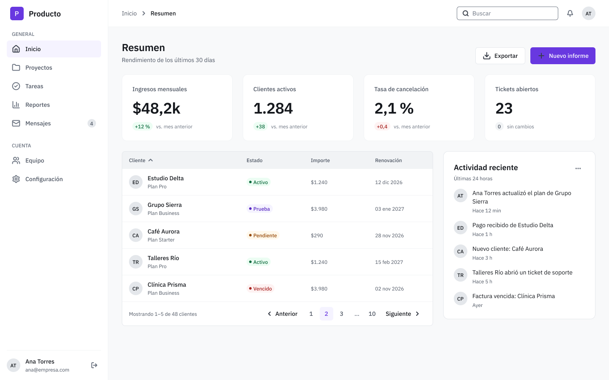
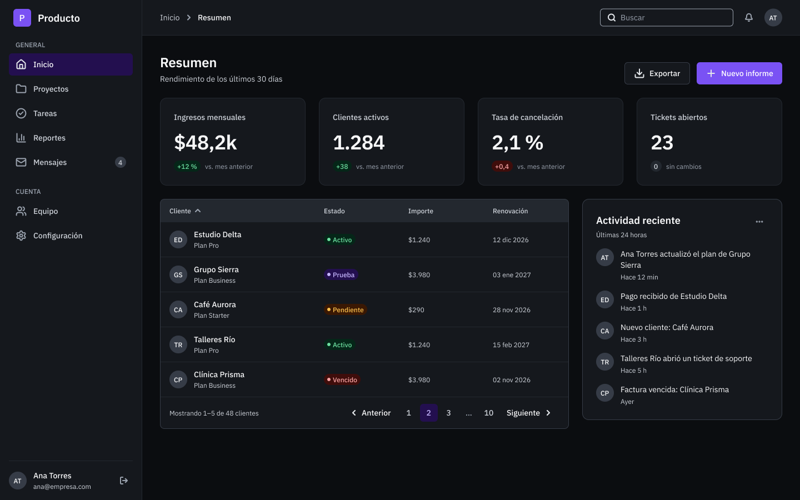
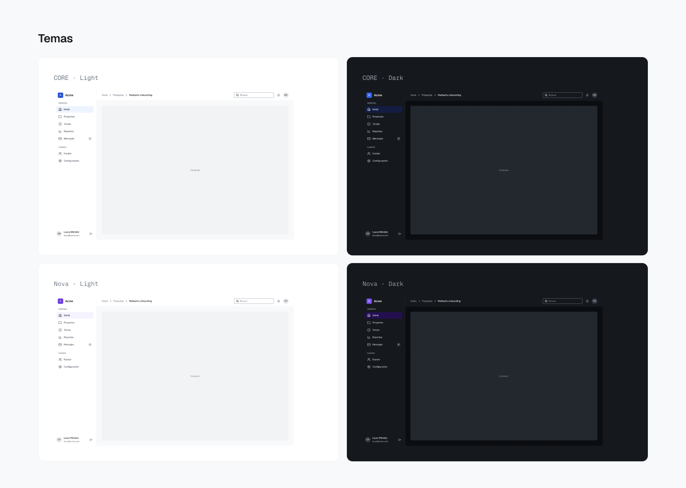

# Temas y marcas

CORE separa dos ejes que en muchos sistemas se mezclan:

- **Tema** (colección `theme`): Light o Dark. Define qué color cumple cada rol: fondo, texto, borde, icono.
- **Marca** (colección `brand`): CORE o Nova. Define el acento y las tipografías.

Como son colecciones distintas, cualquier marca funciona con cualquier tema. Las cuatro combinaciones usan los mismos componentes, sin variantes duplicadas.

| | Light | Dark |
|---|---|---|
| **CORE** (acento azul, Geist) |  |  |
| **Nova** (acento violeta, IBM Plex) |  |  |

## Light y Dark

El modo Dark no es una inversión automática: cada rol se eligió para su contexto. Algunos ejemplos reales de la colección `theme`:

| Rol | Light | Dark | Motivo |
|---|---|---|---|
| `bg/canvas` | `gray/50` | `gray/950` | Fondo de la aplicación |
| `bg/action/primary` | `accent/600` | `accent/500` | Un paso más claro en Dark |
| `bg/action/primary-hover` | `accent/700` | `accent/600` | En Dark el hover oscurece el acento para conservar 4,5:1 con texto blanco |
| `text/link` | `accent/600` | `accent/300` | Legibilidad sobre fondo oscuro |
| `border/focus` | `accent/500` | `accent/400` | Anillo de foco visible en ambos temas (mínimo 3:1) |
| `bg/overlay` | `gray-alpha/50` | `gray-alpha/70` | Fondo de los diálogos modales |

Tabla completa en [Variables](variables.md#theme).

## CORE y Nova

| Variable | CORE | Nova |
|---|---|---|
| `brand/accent/50–950` | `color/blue/50–950` | `color/violet/50–950` |
| `brand/font/sans` | Geist | IBM Plex Sans |
| `brand/font/mono` | Geist Mono | IBM Plex Mono |

Nova es una marca ficticia creada para demostrar el cambio de identidad.

## Adaptar CORE a otra marca

1. Agrega la escala de color de la marca en `primitives` (11 pasos, de 50 a 950) y, si hace falta, sus familias tipográficas.
2. Agrega un modo nuevo en la colección `brand`.
3. En ese modo, re-apunta los 11 alias `brand/accent/*` a la nueva escala y, si corresponde, `brand/font/sans` y `brand/font/mono`.
4. Comprueba el contraste de los roles que usan el acento (`bg/action/primary`, `text/link`, `border/focus` y los demás) en Light y Dark.

Los semánticos y los componentes no se modifican.

## En código

Cada modo corresponde a un archivo de tokens. Para resolver una combinación se cargan juntos `primitives`, una marca, un tema y `dimension` (ver [tokens/README.md](../tokens/README.md)). La traducción de nombre a CSS custom property sigue el patrón `bg/action/primary` → `--core-bg-action-primary`.
