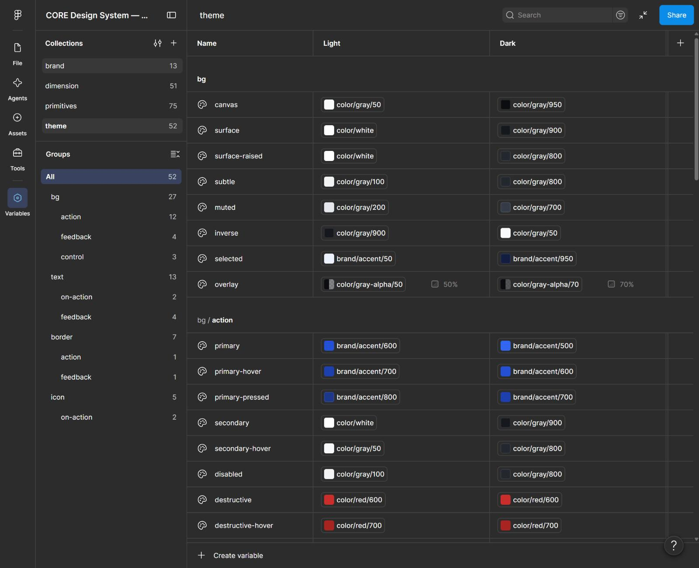

# Variables

191 variables en 4 colecciones, exportadas tal como están en el archivo maestro. Los archivos equivalentes en formato DTCG están en [`tokens/`](../tokens).

*Panel de variables de Figma: colección `theme`, modos Light y Dark (captura real de la interfaz).*

| Colección | Modos | Variables | Alcances en Figma |
|---|---|---|---|
| `primitives` | Value | 75 | Ninguno: ocultas en los selectores, solo se usan como alias |
| `brand` | CORE · Nova | 13 | Acento: ninguno (solo alias) · Fuentes: `FONT_FAMILY` |
| `theme` | Light · Dark | 52 | Por rol: `FRAME_FILL`/`SHAPE_FILL`, `TEXT_FILL`, `STROKE_COLOR` |
| `dimension` | Default | 51 | `GAP`, `CORNER_RADIUS`, `WIDTH_HEIGHT`, `STROKE_FLOAT` |

Los alcances limitan dónde aparece cada variable en Figma: por ejemplo, `text/*` solo se ofrece para color de texto y `space/*` solo para padding y separación.

## primitives

Escalas `gray` (25–950), `blue`, `green`, `amber`, `red` y `violet` (50–950), `white`, `black`, `gray-alpha/50` y `/70`, y cuatro familias tipográficas: `font/family/geist`, `geist-mono`, `ibm-plex-sans` e `ibm-plex-mono`. Valores en [Foundations](foundations.md#primitivos).

## brand

| Variable | CORE | Nova |
|---|---|---|
| `brand/accent/50` | `color/blue/50` | `color/violet/50` |
| `brand/accent/100` | `color/blue/100` | `color/violet/100` |
| `brand/accent/200` | `color/blue/200` | `color/violet/200` |
| `brand/accent/300` | `color/blue/300` | `color/violet/300` |
| `brand/accent/400` | `color/blue/400` | `color/violet/400` |
| `brand/accent/500` | `color/blue/500` | `color/violet/500` |
| `brand/accent/600` | `color/blue/600` | `color/violet/600` |
| `brand/accent/700` | `color/blue/700` | `color/violet/700` |
| `brand/accent/800` | `color/blue/800` | `color/violet/800` |
| `brand/accent/900` | `color/blue/900` | `color/violet/900` |
| `brand/accent/950` | `color/blue/950` | `color/violet/950` |
| `brand/font/sans` | `font/family/geist` | `font/family/ibm-plex-sans` |
| `brand/font/mono` | `font/family/geist-mono` | `font/family/ibm-plex-mono` |

## theme

| Variable | Light | Dark | Uso |
|---|---|---|---|
| `bg/canvas` | `color/gray/50` | `color/gray/950` | Fondo de la página o aplicación |
| `bg/surface` | `color/white` | `color/gray/900` | Superficie base: cards, paneles, tablas |
| `bg/surface-raised` | `color/white` | `color/gray/800` | Superficie elevada: menús, popovers, modales |
| `bg/subtle` | `color/gray/100` | `color/gray/800` | Fondo sutil: filas alternas, áreas secundarias |
| `bg/muted` | `color/gray/200` | `color/gray/700` | Fondo atenuado: tracks, separadores gruesos |
| `bg/inverse` | `color/gray/900` | `color/gray/50` | Fondo invertido: tooltips |
| `bg/selected` | `brand/accent/50` | `brand/accent/950` | Elemento seleccionado o activo |
| `bg/action/primary` | `brand/accent/600` | `brand/accent/500` | Acción principal |
| `bg/action/primary-hover` | `brand/accent/700` | `brand/accent/600` | Acción principal en hover |
| `bg/action/primary-pressed` | `brand/accent/800` | `brand/accent/700` | Acción principal presionada |
| `bg/action/secondary` | `color/white` | `color/gray/900` | Acción secundaria |
| `bg/action/secondary-hover` | `color/gray/50` | `color/gray/800` | Acción secundaria en hover |
| `bg/action/disabled` | `color/gray/100` | `color/gray/800` | Acción deshabilitada |
| `bg/feedback/info` | `brand/accent/50` | `brand/accent/950` | Mensaje informativo |
| `bg/feedback/success` | `color/green/50` | `color/green/950` | Mensaje de éxito |
| `bg/feedback/warning` | `color/amber/50` | `color/amber/950` | Mensaje de advertencia |
| `bg/feedback/error` | `color/red/50` | `color/red/950` | Mensaje de error |
| `bg/action/destructive` | `color/red/600` | `color/red/600` | Acción destructiva (eliminar, revocar) |
| `text/primary` | `color/gray/900` | `color/gray/50` | Texto principal |
| `text/secondary` | `color/gray/600` | `color/gray/300` | Texto secundario |
| `text/tertiary` | `color/gray/500` | `color/gray/400` | Texto terciario: ayudas, metadatos |
| `text/disabled` | `color/gray/400` | `color/gray/600` | Texto deshabilitado (exento de contraste) |
| `text/inverse` | `color/white` | `color/gray/900` | Texto sobre bg/inverse |
| `text/on-action/primary` | `color/white` | `color/white` | Texto sobre bg/action/primary |
| `text/link` | `brand/accent/600` | `brand/accent/300` | Enlace |
| `text/link-hover` | `brand/accent/700` | `brand/accent/200` | Enlace en hover |
| `text/feedback/info` | `brand/accent/700` | `brand/accent/300` | Texto informativo |
| `text/feedback/success` | `color/green/700` | `color/green/300` | Texto de éxito |
| `text/feedback/warning` | `color/amber/700` | `color/amber/300` | Texto de advertencia |
| `text/feedback/error` | `color/red/700` | `color/red/300` | Texto de error |
| `border/subtle` | `color/gray/100` | `color/gray/800` | Borde decorativo muy suave |
| `border/default` | `color/gray/200` | `color/gray/700` | Borde por defecto de superficies |
| `border/strong` | `color/gray/500` | `color/gray/400` | Borde de controles de formulario (3:1) |
| `border/focus` | `brand/accent/500` | `brand/accent/400` | Anillo de foco |
| `border/action/primary` | `brand/accent/600` | `brand/accent/500` | Borde de acción principal |
| `border/feedback/error` | `color/red/600` | `color/red/400` | Borde de campo con error |
| `icon/primary` | `color/gray/700` | `color/gray/200` | Icono principal |
| `icon/secondary` | `color/gray/500` | `color/gray/400` | Icono secundario |
| `icon/disabled` | `color/gray/300` | `color/gray/600` | Icono deshabilitado |
| `icon/on-action/primary` | `color/white` | `color/white` | Icono sobre bg/action/primary |
| `bg/action/destructive-hover` | `color/red/700` | `color/red/700` | Acción destructiva en hover |
| `bg/action/destructive-pressed` | `color/red/800` | `color/red/800` | Acción destructiva presionada |
| `bg/action/secondary-pressed` | `color/gray/100` | `color/gray/700` | Acción secundaria presionada |
| `bg/action/tertiary-hover` | `color/gray/100` | `color/gray/800` | Acción terciaria (sin fondo) en hover |
| `bg/action/tertiary-pressed` | `color/gray/200` | `color/gray/700` | Acción terciaria presionada |
| `text/on-action/destructive` | `color/white` | `color/white` | Texto sobre bg/action/destructive |
| `icon/on-action/destructive` | `color/white` | `color/white` | Icono sobre bg/action/destructive |
| `border/hover` | `color/gray/700` | `color/gray/300` | Borde de control en hover |
| `bg/control/unchecked` | `color/gray/500` | `color/gray/500` | Pista de Switch apagado (3:1 contra la superficie) |
| `bg/control/unchecked-hover` | `color/gray/600` | `color/gray/400` | Pista de Switch apagado en hover |
| `bg/control/thumb` | `color/white` | `color/white` | Perilla de Switch y punto de Radio seleccionado |
| `bg/overlay` | `color/gray-alpha/50` | `color/gray-alpha/70` | Fondo semitransparente detrás de Dialog y otros overlays modales. |

## dimension

| Variable | Valor | Descripción | Alcance |
|---|---|---|---|
| `space/0` | 0 | 0px | GAP |
| `space/2` | 2 | 2px | GAP |
| `space/4` | 4 | 4px | GAP |
| `space/6` | 6 | 6px | GAP |
| `space/8` | 8 | 8px | GAP |
| `space/12` | 12 | 12px | GAP |
| `space/16` | 16 | 16px | GAP |
| `space/20` | 20 | 20px | GAP |
| `space/24` | 24 | 24px | GAP |
| `space/32` | 32 | 32px | GAP |
| `space/40` | 40 | 40px | GAP |
| `space/48` | 48 | 48px | GAP |
| `space/64` | 64 | 64px | GAP |
| `space/80` | 80 | 80px | GAP |
| `space/96` | 96 | 96px | GAP |
| `radius/none` | 0 | 0px | CORNER_RADIUS |
| `radius/xs` | 2 | 2px | CORNER_RADIUS |
| `radius/sm` | 4 | 4px | CORNER_RADIUS |
| `radius/md` | 6 | 6px | CORNER_RADIUS |
| `radius/lg` | 8 | 8px | CORNER_RADIUS |
| `radius/xl` | 12 | 12px | CORNER_RADIUS |
| `radius/2xl` | 16 | 16px | CORNER_RADIUS |
| `radius/full` | 9999 | Píldora | CORNER_RADIUS |
| `size/control/sm` | 32 | Alto de control sm: 32px | WIDTH_HEIGHT |
| `size/control/md` | 40 | Alto de control md: 40px | WIDTH_HEIGHT |
| `size/control/lg` | 48 | Alto de control lg: 48px | WIDTH_HEIGHT |
| `size/icon/sm` | 16 | Icono sm: 16px | WIDTH_HEIGHT |
| `size/icon/md` | 20 | Icono md: 20px | WIDTH_HEIGHT |
| `size/icon/lg` | 24 | Icono lg: 24px | WIDTH_HEIGHT |
| `border-width/default` | 1 | 1px | STROKE_FLOAT |
| `border-width/strong` | 2 | 2px | STROKE_FLOAT |
| `breakpoint/md` | 768 | Tablet: desde 768 px | WIDTH_HEIGHT |
| `breakpoint/lg` | 1280 | Desktop: desde 1280 px | WIDTH_HEIGHT |
| `breakpoint/xl` | 1536 | Desktop amplio: desde 1536 px | WIDTH_HEIGHT |
| `grid/columns/mobile` | 4 | Columnas en mobile | — |
| `grid/columns/tablet` | 8 | Columnas en tablet | — |
| `grid/columns/desktop` | 12 | Columnas en desktop | — |
| `grid/gutter/mobile` | 16 | Separación entre columnas en mobile | GAP |
| `grid/gutter/tablet` | 24 | Separación entre columnas en tablet | GAP |
| `grid/gutter/desktop` | 24 | Separación entre columnas en desktop | GAP |
| `grid/margin/mobile` | 16 | Margen lateral en mobile | GAP |
| `grid/margin/tablet` | 24 | Margen lateral en tablet | GAP |
| `grid/margin/desktop` | 32 | Margen lateral en desktop | GAP |
| `layout/sidebar/width` | 256 | Ancho de la navegación lateral expandida | WIDTH_HEIGHT |
| `layout/sidebar/collapsed` | 72 | Ancho de la navegación lateral colapsada | WIDTH_HEIGHT |
| `layout/header/height` | 64 | Alto de la barra superior | WIDTH_HEIGHT |
| `layout/content/max-width` | 1280 | Ancho máximo del contenido | WIDTH_HEIGHT |
| `size/avatar/xs` | 24 | Diámetro del Avatar xs. | WIDTH_HEIGHT |
| `size/avatar/sm` | 32 | Diámetro del Avatar sm. | WIDTH_HEIGHT |
| `size/avatar/md` | 40 | Diámetro del Avatar md. | WIDTH_HEIGHT |
| `size/avatar/lg` | 48 | Diámetro del Avatar lg. | WIDTH_HEIGHT |
